# n900-gothi

A [Flipper Zero](https://flipperzero.one) style interface for the **Nokia N900** (Maemo 5), written in Python 3: the 128×64 one-bit screen with the orange look, six keys, menus and small
applications. The graphics are the original ones of the [Flipper firmware](https://github.com/flipperdevices/flipperzero-firmware), read straight from its source tree.
It is not an emulator of the Flipper and has none of its radios (Sub-GHz, NFC, RFID); the idea is the same interface on top of what the N900 has (battery, GPS, Wi-Fi, FM, USB host, ...).

Successor of [RPi_Zero_Gothi](https://github.com/elPytel/RPi_Zero_Gothi) (Raspberry Pi Zero with an OLED HAT).

> **MVP.** Works on the N900 and on the PC: the menu with the firmware icons, a clock, battery data, a key test, a **Dolphin** (the animations of the firmware as on the Flipper desktop: picked by weight, level and mood, passive and active frames, speech bubbles; **OK** = the dolphin acts, **Right** = the next one), a player of single animations, a **character** (XP, three levels, butthurt) with its own stats screen, settings (colour, screen size, happy mode), a `.deb` package. Everything else is still to do.

## Screenshots

| menu | touch layout | Dolphin | Dolphin stats (tall screen) |
|---|---|---|---|
|  |  |  |  |

| Settings | Volume | Wi-Fi |
|---|---|---|
|  |  |  |

*(Rendered on a computer with the same code; the modules in the last row use made-up values.)*

## Touching the screen itself

With **Settings > Tap the screen** on (off by default: a palm on a phone held with both hands must not press things) a finger works on the screen itself, in both layouts (also with the keyboard slid out):

- **Lists:** a tap selects a row, a tap on the selected row opens it (like OK); a **drag** scrolls the list; a tap on the **title bar** is Back. In a list of buttons for a remote control (the `gothi-ir` module) one tap sends.
- **Settings:** the same; on the colour page a tap on a bar sets the channel there.
- **Switches and levels:** a tap on the big ON/OFF toggles; on the `< value >` line the left and the right end change the number; a tap on the bar of a level sets it; the question before a start is answered with the left (yes) or the right (no) half of its last line; the lines under the state scroll with a drag.
- **Dolphin:** a tap pets it, the right edge shows the next animation. A message closes with a tap. **Key test** shows where the finger was.
- Taps and drags are told apart by a threshold of 3 canvas pixels (18 on the display), so the jitter of the resistive screen does not scroll. `python3 -m gothi --keys tap:64:30,swipe:64:50:10` tries it without a finger.

## Two ways to control it

| Keyboard slid out | Keyboard closed |
|---|---|
| The screen as big as it can be (×6). Arrows, **Enter** = OK, **Backspace**, **Esc** or **Ctrl** = Back | The screen (×4) on the left, a cross and a Back button on the right; the touch screen works, held arrows repeat |

The N900 chooses by the keyboard slide (`/sys/devices/platform/gpio-switch/slide/state`). On the PC **F2** switches by hand; `--mode keyboard|touch` fixes it.

## Run

On the PC:
```sh
python3 -m venv .venv && .venv/bin/pip install pysdl2 pysdl2-dll
./tools/fetch-assets.sh                # the Flipper graphics (GPL-3.0, not in this repository)
.venv/bin/python -m gothi              # --mode touch, --windowed
python3 -m unittest discover -s tests  # tests need no display
```

On the phone, as a package (section Utilities, menu entry "gothi"): built in the project [nokia-n900-apps](https://github.com/n900-resurrection/nokia-n900-apps), where this repository is `apps/n900-gothi`:
```sh
make -C apps/pysdl2 install            # python3-pysdl2 (needs python3.11 and libsdl2 of the project repository)
make -C apps/n900-gothi install        # the package gothi; `make deb` only builds it, `make test` runs 10 tests on the phone
```
For development, without a package: `./tools/deploy-n900.sh` copies the source tree and PySDL2 to the phone.

## Design

- `gothi/canvas.py`: the screen, a 128×64 array; lines, boxes, text, blit. **No Pillow, no numpy** (they do not exist for Maemo 5). The font `gothi/font.py` (Tiny5, SIL OFL, Google Fonts) is generated by `tools/mkfont.py`, the only tool that needs Pillow.
- `gothi/ui.py`: scenes on a stack (like the view dispatcher of the Flipper firmware), `Menu` with the inverted selected row and the scroll bar.
- `gothi/modules.py`: discovery of modules and the `switch` scene.
- `gothi/dolphin.py` + `gothi/rules.json`: XP, levels, butthurt (logic and numbers apart).
- `gothi/apps.py`: the applications. `gothi/sysinfo.py`: battery (`hal-device` on the phone), keyboard slide.
- `gothi/flipper.py`: reads the **firmware asset layout as it is**: 1-bit PNGs (own decoder, checked against Pillow on all 1276 files of the firmware), `meta.txt` (frame rate, frame order, speech bubbles), `manifest.txt`, animated icons. New graphics of the firmware: run `tools/fetch-assets.sh` again.
- `gothi/sdl_frontend.py`: SDL 2 through PySDL2, the same code on the PC and the N900. The screen is a 128×64 RGB565 surface scaled by the window blit (nearest), only when something changed.

## The dolphin: XP, levels and butthurt

Modelled on `applications/services/dolphin` of the Flipper firmware. Using the apps gives the dolphin XP (*deeds*), XP gives levels, and doing nothing makes it sad:

- every deed has a weight in XP and belongs to a group; a group gives at most `default_limit` XP a day (20); the day starts at 05:00;
- levels: level 2 after 300 XP, level 3 after 1800 XP; the XP waits on the threshold until the level-up is shown;
- butthurt (0 to 14): +1 every 48 hours, -1 for each of the daily XP steps 1, 16, 31 and 46 (at most -4 a day); the animations of the Dolphin screen are picked by level and butthurt;
- **Settings > Happy mode** shows the animations as if butthurt was 0 (the real value is kept); the screen **Dolphin stats** shows level, XP, mood and today's XP per group.

The numbers are **not in the code**. They are in `gothi/rules.json` (installed in `/opt/gothi/lib/gothi/rules.json`): level thresholds, daily limits, the butthurt rules and every deed with its group and XP. To change something write only the changed values to `~/.config/gothi/rules.json`; dicts are merged, lists and numbers replaced, so for example

```json
{"levels": [100, 600], "deeds": {"clock_view": {"xp": 0}, "wifi_scan": {"group": "radio", "xp": 3}}}
```

makes the levels faster, stops XP for the clock and adds a new deed. A deed name nobody reports (like `wifi_scan` before that module exists) does nothing; a broken file is ignored and the shipped rules are used. `gothi --rules` prints the paths. The state (XP, butthurt, timestamps) is in `~/.config/gothi/dolphin-state.json`; delete it to start over. The animations of the firmware know three levels, so more thresholds than two only help with new graphics.

New code reports a deed with `gothi.deed("name")`, or a scene sets `deed_name` to get it when it opens.

## Modules

Features that need more than stock Maemo are **modules**: they are installed on their own (a `.deb` that needs gothi) and show up in the menu **Modules** after the next start of gothi. A module is a folder with a manifest `module.json` in `/opt/gothi/modules/<name>/` (packages) or `~/.config/gothi/modules/<name>/` (yours, no root needed; the same name in your folder replaces the packaged one). `gothi --modules` lists the folders and what was found. A broken module is shown as a line `! name` in the menu (OK shows why) and the rest works.

What is a module and what is not: the **core** is what needs nothing beyond stock Maemo and is always wanted (clock, battery, dolphin, settings). The rest uses the same mechanism; if it depends on another package (a file server) it is a package of its own, if it needs only the stock system it may be bundled in `gothi` but is still loaded as a module.

Six kinds exist, five of them need **no Python**, only shell commands: `switch` (on/off of a service), `action` (runs one command, shows the lines it printed, scrolls), `level` (a number that Left/Right change), `monitor` (a command that runs while the page is open, every block of lines closed by an empty line replaces the page: the GPS) and `ask` (see below). A `switch`:

```json
{"title": "File server", "type": "switch",
 "status": "copyparty-share status | grep -q '^Running'",
 "start": "copyparty-share start", "stop": "copyparty-share stop",
 "info": "copyparty-share url",
 "deed": "fileserver_toggle", "deeds": {"fileserver_toggle": {"group": "modules", "xp": 2}}}
```

`status` exits 0 when the service is on, `info` (optional) prints lines that are shown while it is on, `icon` (optional) is a 1-bit PNG in the folder, `deed` and `deeds` give the dolphin XP for a toggle (merged into the [rules](#the-dolphin-xp-levels-and-butthurt), you can still override them). The commands run in the background with a time limit and the screen asks again every 5 seconds while it is open. The kind `level` has `get` (prints the value, the first number is taken), `set` (`{value}` is replaced by the number; while a `set` runs the last value wins) and `min`, `max`, `step`, `unit`; the value read back does not overwrite a choice made in the last 3 seconds.

Every manifest may have `"menu": "settings"` (the entry goes to **Settings**, after the built-in rows, instead of the menu Modules) and `"requires": ["/usr/bin/amixer"]` (paths that must exist; when one is missing the module is simply not offered, no error).

**Bundled modules** (folder `modules/` of this repository, installed to `/opt/gothi/modules/`; they use only the stock system, so they are part of the package, but still go through the same mechanism and can be replaced by a folder of the same name in `~/.config/gothi/modules/`):

| module | what | how |
|---|---|---|
| Volume | 0 to 100 % | `amixer sset Master` (the master of PulseAudio) |
| Brightness | 1 to 5 | the GConf key of the display (`gconftool-2`), the system applies it |
| Bluetooth | on / off | `hciconfig hci0 up/down` through `sudo gainroot` |
| Wi-Fi | on / off, network and address | `wifi.sh` of the package `wifi-switcher` (recommended by the package; without it the entry is not shown) |
| Wi-Fi scan | the networks around, channels, summary, saved networks (menu Modules) | `iwlist wlan0 scan`, see [below](#wi-fi-scan) |
| Flashlight | the flash LED as a torch, switches off by itself after 15 minutes (menu Modules) | V4L2, see [below](#flashlight) |
| Bluetooth scan | the discoverable devices around, summary, known devices (menu Modules) | `hcitool scan`, see [below](#bluetooth-scan) |
| Sensors | accelerometer, bubble level, light, switches such as the keyboard slide (menu Modules) | sysfs, see [below](#sensors) |

### Wi-Fi scan

The bundled module **Wi-Fi scan** (menu Modules) shows what the phone's Wi-Fi hears. It is passive: it lists what the access points announce, nothing is sent to them and nothing connects.

| 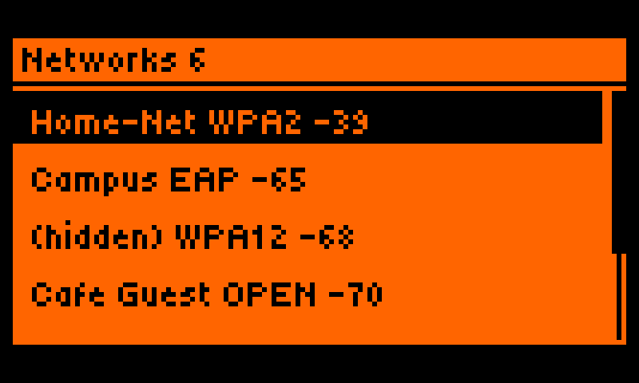 | 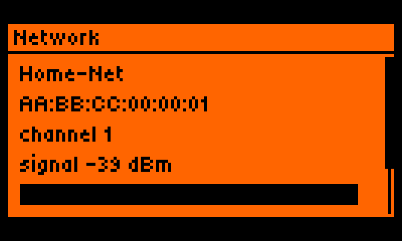 | 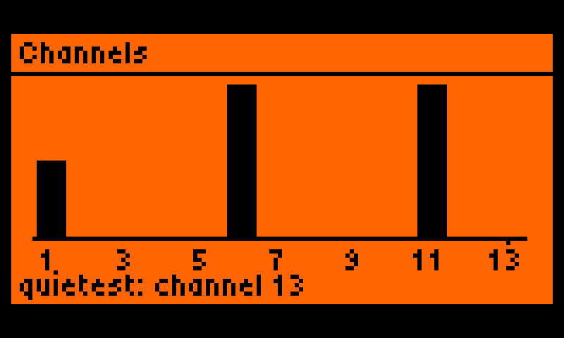 |
|---|---|---|
| 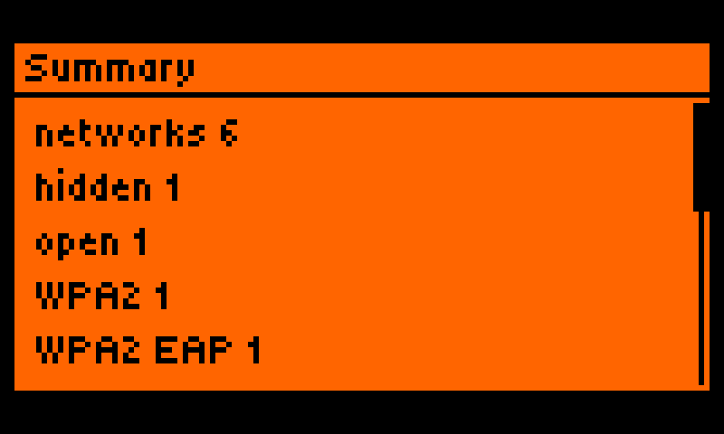 | 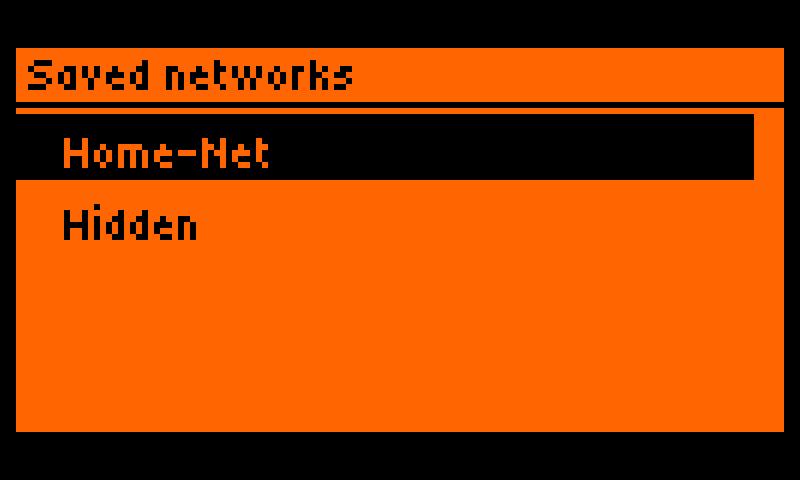 | |

(Made on a computer with a made-up list of networks.)

- **Networks**: the strongest first, name, security (`OPEN`, `WEP`, `WPA`, `WPA2`, `WPA12` = both, `EAP`) and the level in dBm. OK opens one: address (BSSID), channel, level with a bar, quality. A hidden network is shown as `(hidden)`.
- **Channels**: how many networks sit on each 2.4 GHz channel and the quietest channel (the neighbours of a channel count too, weighted by their level). The N900 has no 5 GHz.
- **Summary**: counts by security, hidden and open networks, the strongest one, and how many different networks were seen since the module was opened.
- **Saved networks**: the Wi-Fi networks stored in the phone (the connection manager's list), `*` marks those in range. It only lists them; connecting is not done yet.

A scan takes about a second and repeats every 5 seconds while one of the screens is on top. A normal user can only read the *results of the last scan* on the N900 (often one network), a fresh scan needs root, so the package installs one narrow `sudo` rule, `user ALL = NOPASSWD: /sbin/iwlist wlan0 scan` (in `/etc/sudoers.d/gothi.sudoers`, removed with the package). Without it the module falls back to the stale results. The data code is `gothi/wifi.py` (parsing, channel and summary maths, saved networks) and is meant to be reused by other modules.

### Sensors

The bundled module **Sensors** (menu Modules) shows the built-in sensors live. They are only read, nothing is written to them, and only while one of its screens is on top. The N900 has an accelerometer, an ambient light sensor and some switches; it has **no gyroscope, compass or barometer** (so no heading and no height), and the accelerometer gives the tilt and the shakes, not the rate of rotation. The design is in [docs/sensors.md](docs/sensors.md).

| 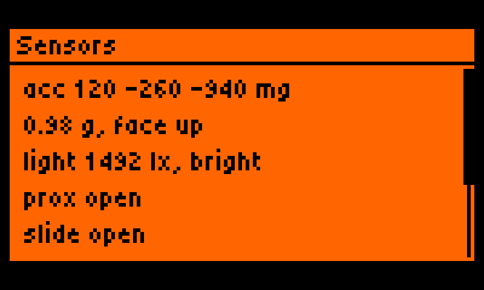 | 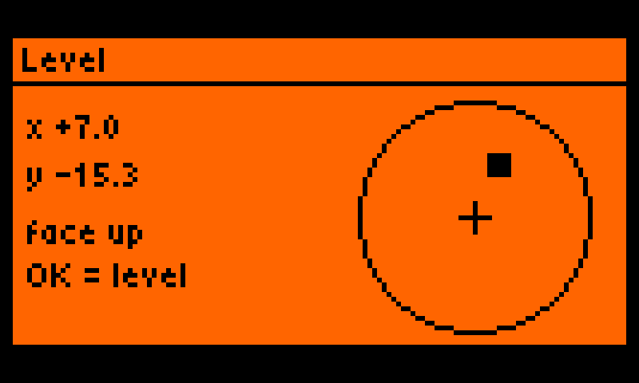 | 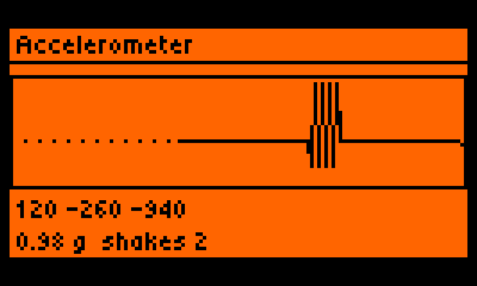 |
|---|---|---|
| 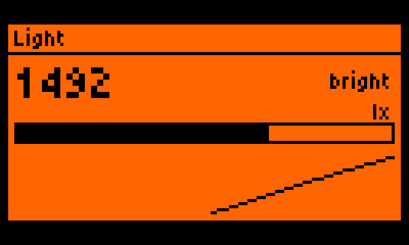 | 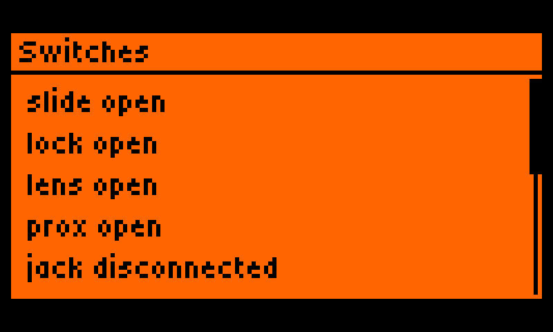 | |

(Made on a computer with made-up readings.)

- **Overview**: the acceleration in mg and in g with how the phone lies, the light in lux, and the switches.
- **Level**: a bubble level with the tilt of the two axes in degrees; OK (or a tap) says "this is level" and keeps it in `~/.config/gothi/sensors.json`; the back of a phone is not perfectly flat, so set the zero on the surface you use it on.
- **Accelerometer**: the strength of the acceleration over the last seconds as a line (the dotted line is 1 g), the three axes and a **shake counter** (stronger than 1.8 g).
- **Light**: lux from the sensor, a logarithmic bar, a word (dark, dim, indoor, bright, sun) and the last minute as a line.
- **Switches**: keyboard slide, keyboard lock, camera lens cover, proximity, headphone jack and the camera buttons, and a **log of changes** (slide the keyboard, cover the lens, plug the headphones, and a line appears). Proximity is a single bit, not a distance: `closed` means something covers the sensor (confirmed with the phone in a case).

The readings come from `/sys/bus/i2c/drivers/lis302dl/3-001d/coord` (mg, 1000 = 1 g), `/sys/class/i2c-adapter/i2c-2/2-0029/lux` and `/sys/devices/platform/gpio-switch/*/state`; the normal user may read all of them. The `enable` file of the accelerometer is left alone. The data code is `gothi/sensors.py` (with the sysfs root as a parameter, so the tests use a fake tree). The axes are those of the screen: x to the right, y down, z into the display; the sensor gives the reaction to gravity, so a positive value means that side is higher and the bubble moves to the high side. The top left corner of the screen is x and y with a minus (told by the author; the rest follows from it). Not yet confirmed on the phone: that normal landscape use reads y near -1000 (the words are "face up", "face down", "landscape", "landscape flipped", "portrait right up", "portrait left up"), (the light sensor refreshes about twice a second, measured by the author; the accelerometer counts the shakes reliably and gives fresh data).

### Flashlight

The bundled module **Flashlight** (menu Modules) is a switch for the **flash LED** of the camera. OK toggles it, the screen shows the time left of the **auto-off** (15 minutes; the timer is detached, so it also works when gothi is closed).

| 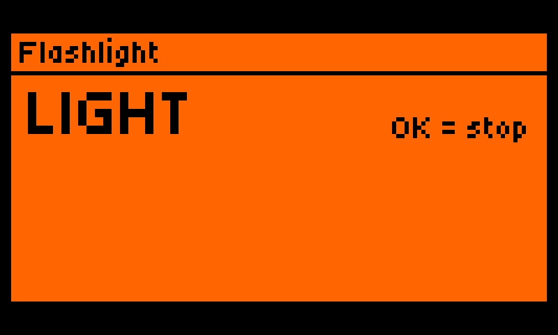 | 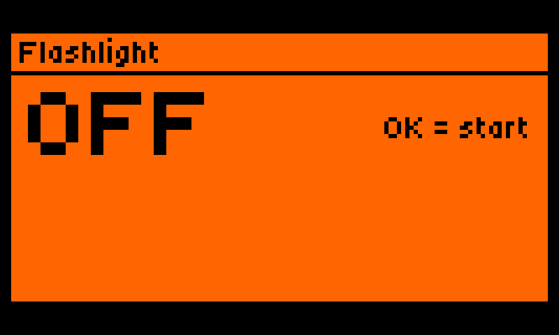 |
|---|---|

The ADP1653 flash driver lets the torch burn only while the camera device (`/dev/video0`) is open, so `modules/flashlight/torch.py start` leaves a small detached process that holds it open and sets the V4L2 control `V4L2_CID_TORCH_INTENSITY` to 1 (the same way as the flashlight applet of Maemo does); `stop` ends that process, which puts the LED out. If the process is killed the LED goes out too. The group `video` may open the device, so no root is needed. **Two modes, torch and flash: estimated currents and times (a warning).** The chip has two modes for the two white LEDs of the flash (they sit in series, driven by one ADP1653; the red indicator LED next to them is separate). The **torch** is a weak steady light, the **flash** a strong pulse for photos. What is written about them (the [Maemo wiki](https://wiki.maemo.org/N900_Hardware_Flash_Torch), the [Leste page](https://leste.maemo.org/Nokia_N900) and the [datasheet](https://www.analog.com/en/products/adp1653.html); the wiki is about 16 years old and not consistent) comes to this, and it is an **estimate, not something measured here**:

| mode | current (estimate) | time |
|---|---|---|
| torch | up to about 50 mA (the wiki also lists steps up to 200 mA) | any length; several hours in a row were reported without a change of brightness or colour |
| flash | up to about 320 mA | at most 0.5 s |
| indicator LED (red) | 2.5 to 17.5 mA | any length |

The module uses the **torch mode only**, never the flash: it sets the V4L2 control *torch intensity* to 0 or 1 and the **driver chooses the current**; gothi cannot read it or raise it. It is the same control that the flashlight applet of Maemo uses. Warning: the current, not the time, is what damages the LEDs: Leste says to use the lowest torch current only, and a higher setting "will probably cause irreversible hardware damage". The chip switches itself off above 155 degrees, which protects the chip and not necessarily the LEDs. So do not add code that writes other values (flash mode, the strobe, other torch steps), and keep the 15 minutes of auto-off (`auto_off` in `modules/flashlight/module.json`); do not leave the torch on in a pocket or under a cover.

The status LED (the coloured one at the top) is a separate matter, see [#22](https://github.com/n900-resurrection/n900-gothi/issues/22).

### Bluetooth scan

The bundled module **Bluetooth scan** (menu Modules) lists the Bluetooth devices around that are *discoverable*: name, kind (phone, audio, input, tv...), address. A scan is an **inquiry**: the phone asks the devices around and they answer (`hcitool scan`, about six seconds plus a second for each device that has to be asked for its name; it works as the normal user). Nothing connects and nothing is paired. Bluetooth has to be on (Settings > Bluetooth): the module says so when it is not.

| 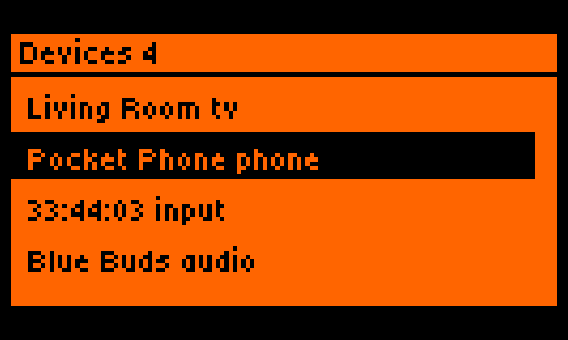 | 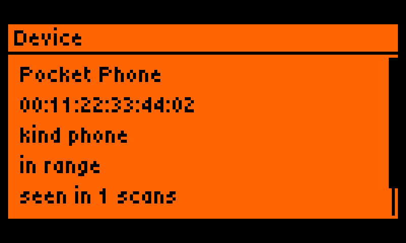 | 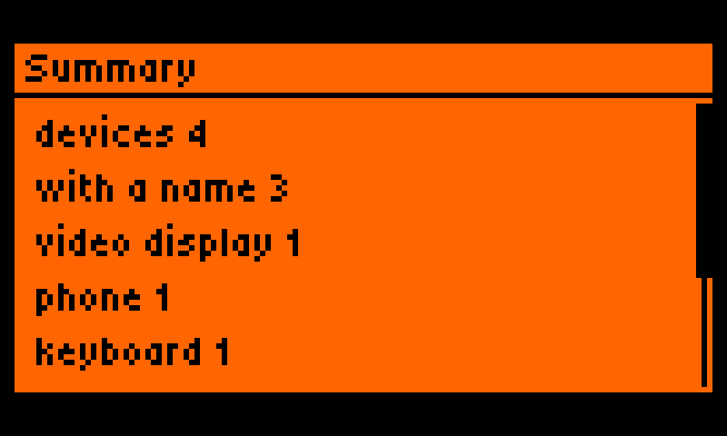 |
|---|---|---|
| 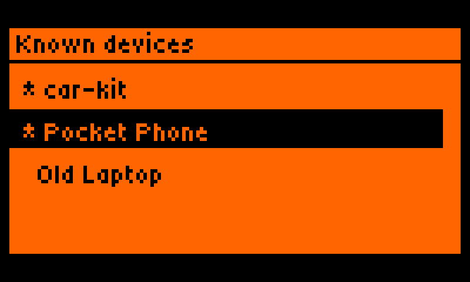 | | |

(Made on a computer with a made-up list of devices.)

- **Devices**: the devices of the last scan; a device that did not tell its name is shown by the end of its address. OK opens one: address, kind (from the class of device), whether it is in range now, in how many scans it was seen.
- **Summary**: counts by kind, devices with a name, and how many different devices were seen since the module was opened.
- **Known devices**: the devices the phone has met before (its own lists in `/var/lib/bluetooth`), `*` marks the paired ones, and when it last saw them. The file with the link keys is read only for the addresses in it, never the keys.

The scan repeats while one of the screens is on top and stops when you leave. An inquiry is a short radio transmission and it can make Bluetooth audio stutter while it runs. There is no signal level in the list: the old BlueZ of the N900 gives one only for connected devices. A modern phone is usually not discoverable unless its Bluetooth settings page is open; Low Energy devices are not found at all (the N900 has Bluetooth 2.1). The data code is `gothi/bluetooth.py`.

A `switch` may also have (all optional): `level` (a number on the same screen, Left/Right change it; `get`, `set`, `min`, `max`, `step`, `unit` and `divisor` + `decimals` to show 90500 as 90.5), `confirm` (a question asked before every start: OK = yes, Back = no), `auto_off` (seconds; after a start a **detached timer** runs `stop`, also when gothi is closed; a manual stop cancels it; the screen shows the time left) and `labels` (the words for on and off, e.g. `ON AIR`). See [gothi-fmtx](https://github.com/n900-resurrection/gothi-fmtx) for all of them together.

The kind `python` is a module with code of its own: the manifest names a file (`"entry": "module.py"`) that defines `create(module)` and returns a scene (see `gothi/ui.py`: `Scene`, `Menu`, `ScrollView`). Files next to it can be imported (give them names of their own, the folder is put in `sys.path`); the folder is looked at again every time the module is opened, so no restart is needed while developing. An error in the module is shown as a page, not as a crash. See [gothi-ir](https://github.com/n900-resurrection/gothi-ir).

The kind `ask` types a question and shows an answer: the question is typed on the keyboard (slide it out; with the keyboard closed the page asks for that), **Enter** asks, **Esc** leaves. The command `run` gets the question in the environment variable `GOTHI_INPUT` (never pasted into the command line, so quotes and `$()` in it do nothing) and what it prints is the answer, shown as it comes in a **speech bubble over an animation of the dolphin** (`animation`: a folder of the firmware, e.g. `L1_Waves_128x50`; `hint`: an example question). Up/Down scroll a long answer, Enter or Esc asks again. See [gothi-tiny](https://github.com/n900-resurrection/gothi-tiny). A scene that wants typed characters sets `text_input = True` and gets them in `on_text()`; `python3 -m gothi --keys` can type in tests: `t:some text`.

The kind `action` has `run` (exit code 0 = done), `info` (optional, shown above and asked again after each run) and `timeout` (seconds, default 90): see [gothi-timesync](https://github.com/n900-resurrection/nokia-n900-apps/tree/master/apps/gothi-timesync). A `switch` may also have `ready`: a command that must succeed after `start` before the screen says ON (the server needs time to start listening). Modules written in Python (`module.py` with `register()`) will come with the first module that needs one. Example: [gothi-copyparty](https://github.com/n900-resurrection/nokia-n900-apps/tree/master/apps/gothi-copyparty).

## Next

GPS, FM, USB OTG modules, wardriving; see the [issues](https://github.com/n900-resurrection/n900-gothi/issues).

## Licence

MIT for the code. The Flipper graphics (downloaded by `tools/fetch-assets.sh`) are GPL-3.0 and belong to Flipper Devices Inc.; this project is not affiliated with it. Font Tiny5: SIL Open Font License 1.1.
