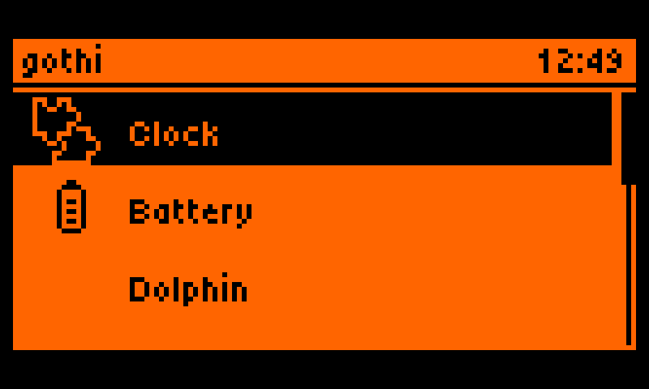
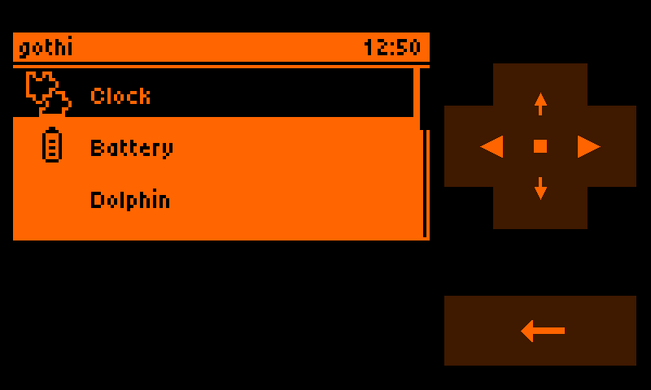
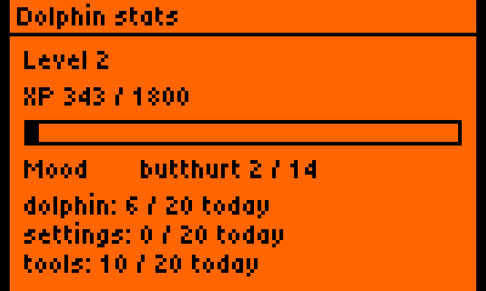
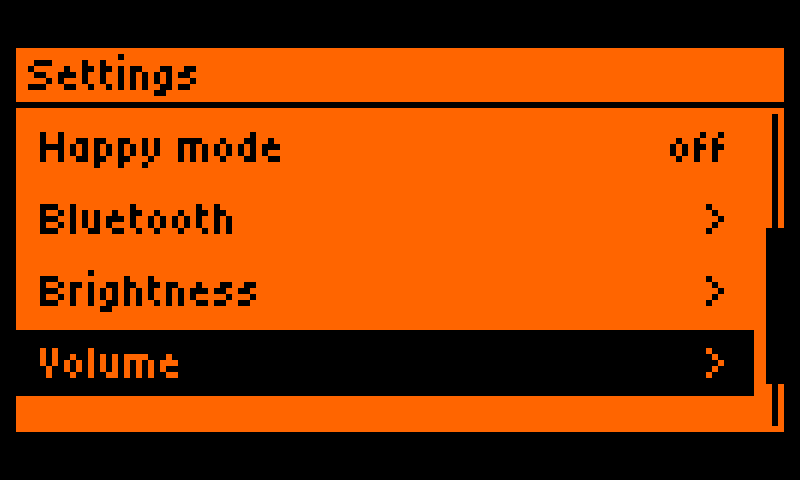
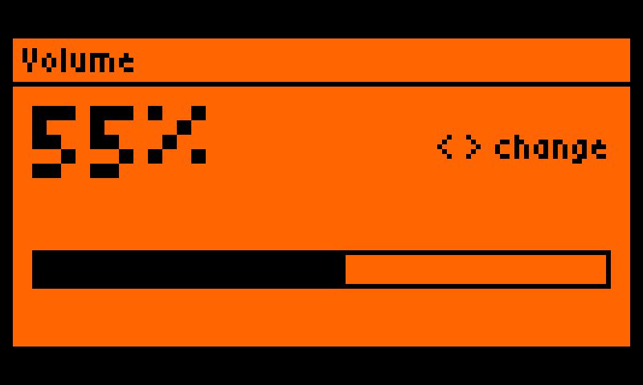
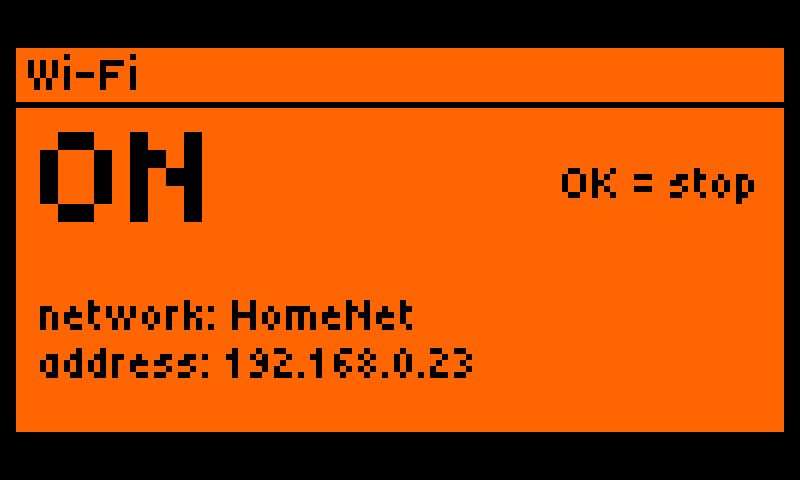

# n900-gothi

A [Flipper Zero](https://flipperzero.one) style interface for the **Nokia N900** (Maemo 5), written in Python 3: the 128×64 one-bit screen with the orange look, six keys, menus and small
applications. The graphics are the original ones of the [Flipper firmware](https://github.com/flipperdevices/flipperzero-firmware), read straight from its source tree.
It is not an emulator of the Flipper and has none of its radios (Sub-GHz, NFC, RFID); the idea is the same interface on top of what the N900 has (battery, GPS, Wi-Fi, FM, USB host, ...).

Successor of [RPi_Zero_Gothi](https://github.com/elPytel/RPi_Zero_Gothi) (Raspberry Pi Zero with an OLED HAT).

> **MVP.** Works on the N900 and on the PC: the menu with the firmware icons, a clock, battery data, a key test, a **Dolphin** (the animations of the firmware as on the Flipper desktop: picked by weight, level and mood, passive and active frames, speech bubbles; **OK** = the dolphin acts, **Right** = the next one), a player of single animations, a **character** (XP, three levels, butthurt) with its own stats screen, settings (colour, screen size, happy mode), a `.deb` package. Everything else is still to do.

## Screenshots

| menu | touch layout | Dolphin | Dolphin stats (tall screen) |
|---|---|---|---|
|  |  |  |  |

| Settings | Volume | Wi-Fi |
|---|---|---|
|  |  |  |

*(Rendered on a computer with the same code; the modules in the last row use made-up values.)*

## Two ways to control it

| Keyboard slid out | Keyboard closed |
|---|---|
| The screen as big as it can be (×6). Arrows, **Enter** = OK, **Backspace**, **Esc** or **Ctrl** = Back | The screen (×4) on the left, a cross and a Back button on the right; the touch screen works, held arrows repeat |

The N900 chooses by the keyboard slide (`/sys/devices/platform/gpio-switch/slide/state`). On the PC **F2** switches by hand; `--mode keyboard|touch` fixes it.

## Run

On the PC:
```sh
python3 -m venv .venv && .venv/bin/pip install pysdl2 pysdl2-dll
./tools/fetch-assets.sh                # the Flipper graphics (GPL-3.0, not in this repository)
.venv/bin/python -m gothi              # --mode touch, --windowed
python3 -m unittest discover -s tests  # tests need no display
```

On the phone, as a package (section Utilities, menu entry "gothi"): built in the project [nokia-n900-apps](https://github.com/n900-resurrection/nokia-n900-apps), where this repository is `apps/n900-gothi`:
```sh
make -C apps/pysdl2 install            # python3-pysdl2 (needs python3.11 and libsdl2 of the project repository)
make -C apps/n900-gothi install        # the package gothi; `make deb` only builds it, `make test` runs 10 tests on the phone
```
For development, without a package: `./tools/deploy-n900.sh` copies the source tree and PySDL2 to the phone.

## Design

- `gothi/canvas.py`: the screen, a 128×64 array; lines, boxes, text, blit. **No Pillow, no numpy** (they do not exist for Maemo 5). The font `gothi/font.py` (Tiny5, SIL OFL, Google Fonts) is generated by `tools/mkfont.py`, the only tool that needs Pillow.
- `gothi/ui.py`: scenes on a stack (like the view dispatcher of the Flipper firmware), `Menu` with the inverted selected row and the scroll bar.
- `gothi/modules.py`: discovery of modules and the `switch` scene.
- `gothi/dolphin.py` + `gothi/rules.json`: XP, levels, butthurt (logic and numbers apart).
- `gothi/apps.py`: the applications. `gothi/sysinfo.py`: battery (`hal-device` on the phone), keyboard slide.
- `gothi/flipper.py`: reads the **firmware asset layout as it is**: 1-bit PNGs (own decoder, checked against Pillow on all 1276 files of the firmware), `meta.txt` (frame rate, frame order, speech bubbles), `manifest.txt`, animated icons. New graphics of the firmware: run `tools/fetch-assets.sh` again.
- `gothi/sdl_frontend.py`: SDL 2 through PySDL2, the same code on the PC and the N900. The screen is a 128×64 RGB565 surface scaled by the window blit (nearest), only when something changed.

## The dolphin: XP, levels and butthurt

Modelled on `applications/services/dolphin` of the Flipper firmware. Using the apps gives the dolphin XP (*deeds*), XP gives levels, and doing nothing makes it sad:

- every deed has a weight in XP and belongs to a group; a group gives at most `default_limit` XP a day (20); the day starts at 05:00;
- levels: level 2 after 300 XP, level 3 after 1800 XP; the XP waits on the threshold until the level-up is shown;
- butthurt (0 to 14): +1 every 48 hours, -1 for each of the daily XP steps 1, 16, 31 and 46 (at most -4 a day); the animations of the Dolphin screen are picked by level and butthurt;
- **Settings > Happy mode** shows the animations as if butthurt was 0 (the real value is kept); the screen **Dolphin stats** shows level, XP, mood and today's XP per group.

The numbers are **not in the code**. They are in `gothi/rules.json` (installed in `/opt/gothi/lib/gothi/rules.json`): level thresholds, daily limits, the butthurt rules and every deed with its group and XP. To change something write only the changed values to `~/.config/gothi/rules.json`; dicts are merged, lists and numbers replaced, so for example

```json
{"levels": [100, 600], "deeds": {"clock_view": {"xp": 0}, "wifi_scan": {"group": "radio", "xp": 3}}}
```

makes the levels faster, stops XP for the clock and adds a new deed. A deed name nobody reports (like `wifi_scan` before that module exists) does nothing; a broken file is ignored and the shipped rules are used. `gothi --rules` prints the paths. The state (XP, butthurt, timestamps) is in `~/.config/gothi/dolphin-state.json`; delete it to start over. The animations of the firmware know three levels, so more thresholds than two only help with new graphics.

New code reports a deed with `gothi.deed("name")`, or a scene sets `deed_name` to get it when it opens.

## Modules

Features that need more than stock Maemo are **modules**: they are installed on their own (a `.deb` that needs gothi) and show up in the menu **Modules** after the next start of gothi. A module is a folder with a manifest `module.json` in `/opt/gothi/modules/<name>/` (packages) or `~/.config/gothi/modules/<name>/` (yours, no root needed; the same name in your folder replaces the packaged one). `gothi --modules` lists the folders and what was found. A broken module is shown as a line `! name` in the menu (OK shows why) and the rest works.

What is a module and what is not: the **core** is what needs nothing beyond stock Maemo and is always wanted (clock, battery, dolphin, settings). The rest uses the same mechanism; if it depends on another package (a file server) it is a package of its own, if it needs only the stock system it may be bundled in `gothi` but is still loaded as a module.

Five kinds need **no Python**, only shell commands: `switch` (on/off of a service), `action` (runs one command, shows the lines it printed, scrolls), `level` (a number that Left/Right change), `monitor` (a command that runs while the page is open, every block of lines closed by an empty line replaces the page: the GPS) and `ask` (see below). A `switch`:

```json
{"title": "File server", "type": "switch",
 "status": "copyparty-share status | grep -q '^Running'",
 "start": "copyparty-share start", "stop": "copyparty-share stop",
 "info": "copyparty-share url",
 "deed": "fileserver_toggle", "deeds": {"fileserver_toggle": {"group": "modules", "xp": 2}}}
```

`status` exits 0 when the service is on, `info` (optional) prints lines that are shown while it is on, `icon` (optional) is a 1-bit PNG in the folder, `deed` and `deeds` give the dolphin XP for a toggle (merged into the [rules](#the-dolphin-xp-levels-and-butthurt), you can still override them). The commands run in the background with a time limit and the screen asks again every 5 seconds while it is open. The kind `level` has `get` (prints the value, the first number is taken), `set` (`{value}` is replaced by the number; while a `set` runs the last value wins) and `min`, `max`, `step`, `unit`; the value read back does not overwrite a choice made in the last 3 seconds.

Every manifest may have `"menu": "settings"` (the entry goes to **Settings**, after the built-in rows, instead of the menu Modules) and `"requires": ["/usr/bin/amixer"]` (paths that must exist; when one is missing the module is simply not offered, no error).

**Bundled modules** (folder `modules/` of this repository, installed to `/opt/gothi/modules/`; they use only the stock system, so they are part of the package, but still go through the same mechanism and can be replaced by a folder of the same name in `~/.config/gothi/modules/`):

| module | what | how |
|---|---|---|
| Volume | 0 to 100 % | `amixer sset Master` (the master of PulseAudio) |
| Brightness | 1 to 5 | the GConf key of the display (`gconftool-2`), the system applies it |
| Bluetooth | on / off | `hciconfig hci0 up/down` through `sudo gainroot` |
| Wi-Fi | on / off, network and address | `wifi.sh` of the package `wifi-switcher` (recommended by the package; without it the entry is not shown) |

A `switch` may also have (all optional): `level` (a number on the same screen, Left/Right change it; `get`, `set`, `min`, `max`, `step`, `unit` and `divisor` + `decimals` to show 90500 as 90.5), `confirm` (a question asked before every start: OK = yes, Back = no), `auto_off` (seconds; after a start a **detached timer** runs `stop`, also when gothi is closed; a manual stop cancels it; the screen shows the time left) and `labels` (the words for on and off, e.g. `ON AIR`). See [gothi-fmtx](https://github.com/n900-resurrection/gothi-fmtx) for all of them together.

The kind `ask` types a question and shows an answer: the question is typed on the keyboard (slide it out; with the keyboard closed the page asks for that), **Enter** asks, **Esc** leaves. The command `run` gets the question in the environment variable `GOTHI_INPUT` (never pasted into the command line, so quotes and `$()` in it do nothing) and what it prints is the answer, shown as it comes in a **speech bubble over an animation of the dolphin** (`animation`: a folder of the firmware, e.g. `L1_Waves_128x50`; `hint`: an example question). Up/Down scroll a long answer, Enter or Esc asks again. See [gothi-tiny](https://github.com/n900-resurrection/gothi-tiny). A scene that wants typed characters sets `text_input = True` and gets them in `on_text()`; `python3 -m gothi --keys` can type in tests: `t:some text`.

The kind `action` has `run` (exit code 0 = done), `info` (optional, shown above and asked again after each run) and `timeout` (seconds, default 90): see [gothi-timesync](https://github.com/n900-resurrection/nokia-n900-apps/tree/master/apps/gothi-timesync). A `switch` may also have `ready`: a command that must succeed after `start` before the screen says ON (the server needs time to start listening). Modules written in Python (`module.py` with `register()`) will come with the first module that needs one. Example: [gothi-copyparty](https://github.com/n900-resurrection/nokia-n900-apps/tree/master/apps/gothi-copyparty).

## Next

Wi-Fi scan, GPS, FM, USB OTG modules; see the [issues](https://github.com/n900-resurrection/n900-gothi/issues).

## Licence

MIT for the code. The Flipper graphics (downloaded by `tools/fetch-assets.sh`) are GPL-3.0 and belong to Flipper Devices Inc.; this project is not affiliated with it. Font Tiny5: SIL Open Font License 1.1.
